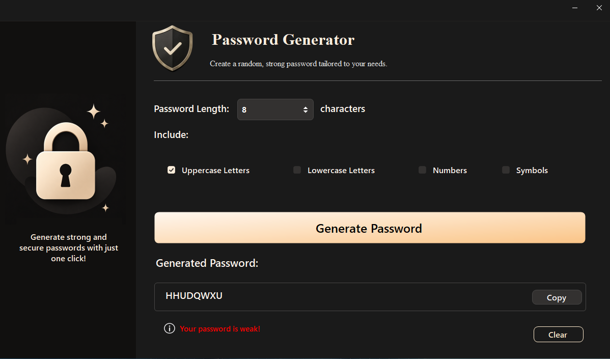

# Password Generator

A simple password generator built with **C#** and **Windows Forms**. The application generates random passwords based on the character types selected by the user and displays an estimated strength level.

## Features

- Choose the password length.
- Include uppercase letters, lowercase letters, numbers, and symbols.
- View an estimated password strength.

## Built With

- C#
- Windows Forms
- Guna UI2

## Note

This project was created for learning and practice. The password strength indicator is a simplified estimate, and the generator is not intended for creating passwords for sensitive or production use.

## 📸 Preview
 

